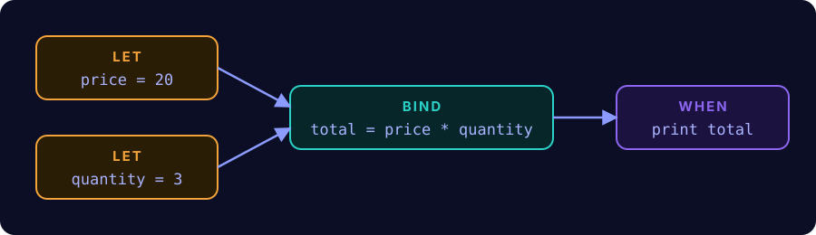

<div align="center">


<br>


[](https://xbkh.github.io/butterfly/)

</div>

A **reactive** programming language, transpiled to Python, with its MCP server.

In Butterfly, you change a single value and everything that depends on it updates by itself: that is the butterfly effect.

<p align="center"></p>

```
let price = 20;
let quantity = 3;
bind total = price * quantity;     # total is ALWAYS price * quantity

when total {                    # runs every time total changes
    print "new total:", total;
}

quantity = 5;                    # prints: new total: 100
price = price + 5;                 # prints: new total: 125
```

- `let` creates a source cell, which can be modified.
- `bind` creates a derived cell, always equal to its formula.
- `when` creates an observer, run when the value of a cell changes.

The website, in English and in French (guide, reference, examples and an in-browser sandbox): **https://xbkh.github.io/butterfly/** (French: [`/fr/`](https://xbkh.github.io/butterfly/fr/index.html))

The full specification is in [`specification.md`](specification.md).

## Installation

You need Python 3.12 or later and [uv](https://docs.astral.sh/uv/).

```bash
git clone https://github.com/xbkh/butterfly.git
cd butterfly
uv sync
```

## Usage

```bash
uv run python -m butterfly run examples/02_cells.fly       # run
uv run python -m butterfly check program.fly                # check without running
uv run python -m butterfly transpile program.fly            # see the generated Python
uv run python -m butterfly format program.fly               # canonical formatting
uv run python -m butterfly tokens program.fly               # the tokens
uv run python -m butterfly ast program.fly                  # the syntax tree
uv run python -m butterfly repl                               # interactive session
```

All errors are reported at once, with the faulty line underlined:

```
Semantic error (line 3, column 1): 'b' is a derived cell (bind), a value cannot be assigned to it
  3 | b = 2;
    | ^
```


## MCP server

The server lets an AI that does not know Butterfly learn it on its own: read the specification and the examples, check, fix, run.

| Tool | Role |
|---|---|
| `tokenize` | splits a program into tokens |
| `parse` | returns the syntax tree as JSON |
| `check` | checks without running, all errors at once |
| `transpile` | returns the generated Python |
| `format` | canonical layout |
| `run` | runs in a bounded process (timeout, output, memory) |

It also exposes the resources `butterfly://specification` and `butterfly://examples`, and the prompts `write_program` and `fix_program`.

To plug it into Claude Code (replace the path):

```bash
claude mcp add butterfly -- uv --directory /absolute/path/to/butterfly run python -m butterfly_server
```

An example configuration is in [`mcp.example.json`](mcp.example.json).

## Tests and quality

```bash
uv run pytest            # 419 tests
uv run mypy butterfly butterfly_server tests   # strict typing
uv run ruff check .      # style
```

The specification is executable: a test reads its table of errors and checks that each faulty program produces exactly the announced message.

## Layout

```
butterfly/            the compiler: lexer, parser, semantics, generator, CLI, REPL
butterfly_server/     the MCP server and its sandbox
examples/             five .fly programs and their expected output (.expected)
specification.md      the language specification
tests/                the language and server tests
site/                 the website (build.py generates the pages from Markdown)
```

The compilation chain uses no parser-generator tool; every stage is written in Python:

```
text → lexer → tokens → parser → tree → analysis → checked tree → generator → Python
```
